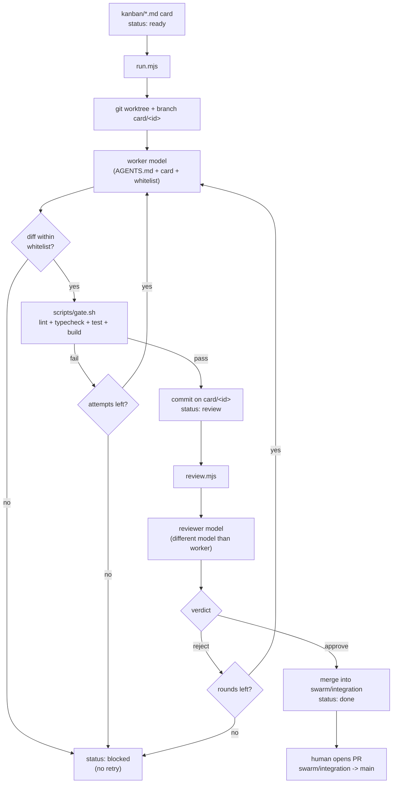

# AI task orchestrator

A small, model-agnostic system that lets an AI model implement scoped tasks
("cards") against this codebase, with a hard quality gate and a second
model acting as reviewer before anything reaches a human. Built as a
learning project to understand how a multi-agent coding loop actually works
end to end, not as a product — see **Limitations** below for an honest
account of what it does and doesn't handle.

## Why this exists

Pointing an AI model at a codebase and asking it to "fix things" works until
it quietly breaks something outside the task, or writes tests that don't
actually test anything. This orchestrator forces every change through the
same checks a human contributor would be expected to pass:

- a file whitelist per task, enforced by diffing the actual changed files —
  not just asked for in the prompt
- the project's own lint/typecheck/test/build pipeline, unmodified
- a second, independent model reviewing the diff before it's considered done

Nothing it produces reaches `main` automatically. The result of a successful
run is a commit on an isolated branch, merged into a throwaway integration
branch — a human still opens a PR to `main`.

## How it works



### Roles

- **Worker** — writes or modifies the files listed in the card's whitelist.
  Receives `AGENTS.md`, the card, and (on a retry) either the last gate
  failure or the reviewer's comments plus its own previous file contents.
- **Reviewer** — a different model than the worker, so it isn't grading its
  own work. Receives the card and the full diff, returns a strict
  `{"verdict": "approve" | "reject", "comments": [...]}` and is explicitly
  told to judge test quality, not just whether the code runs.

Both roles are configured in `swarm/config.json` — provider and model per
role, independent of each other. Today both map to the `gemini-api`
provider with different Gemini models; swapping either to a different
provider (e.g. a different vendor's API, behind an API key) means adding one
function to `swarm/models.mjs` and does not touch `run.mjs` or `review.mjs`.

### The quality gate

`scripts/gate.sh` runs, in order: `npm run lint`, `npm run typecheck`,
`npm test -- --run`, `npm run build`. It's the project's actual pipeline —
the orchestrator doesn't get a looser version of it. `set -euo pipefail`
plus a trap means it stops at the first failing step and says which one.

### Enforcement, not just instructions

`AGENTS.md` tells the model about forbidden zones (auth, Supabase config,
secrets, deploy config, the orchestrator itself) and the file whitelist. The
orchestrator does not trust that it listened: after every worker attempt it
runs `git diff --name-only` in the card's worktree and checks the result
against both the whitelist and a hardcoded forbidden-zone list
(`swarm/forbidden.mjs`). Any file outside the whitelist, or inside a
forbidden zone, is a hard rejection — no retry, because a model that wrote
outside its scope isn't a problem a fix-up prompt should paper over.

### Isolation

Each card runs in its own `git worktree` (`.worktrees/card-<id>`) on its own
branch (`card/<id>`) — the user's own checkout and `main` are never touched.
Approved cards are merged into `swarm/integration` (its own worktree,
`.worktrees/integration`), never into `main` directly.

## Running it

```bash
# one card, start to "review" or "blocked"
node swarm/run.mjs 001

# a card sitting at "review": send it to the reviewer
node swarm/review.mjs 001

# several ready cards at once (see trade-offs in swarm/runMany.mjs)
node swarm/runMany.mjs 001 002 003
```

A card's `kanban/*.md` status moves through:
`ready → running → review → done`, or `blocked` at any failure point with
the reason in `swarm/logs/<id>-*.log` (gitignored — these are run artifacts,
not source).

Configuration (`swarm/config.json`): which provider/model each role uses,
`limits.maxAttempts` (worker fix attempts and reviewer rounds, shared
budget), `limits.timeoutMs` (per model call — large prompts with a
"thinking" model can take minutes).

Requires `GEMINI_API_KEY` in `.env` (loaded via Node's built-in
`process.loadEnvFile`, no extra dependency).

## Limitations

Written down honestly rather than glossed over:

- **The worker has no filesystem access.** It's a single text completion
  that must output full file contents in a specific `### FILE: path` /
  `### END FILE` format, parsed with a regex. This works, but it's less
  robust than a model with actual file-editing tools (e.g. a CLI agent) —
  it can only create or fully rewrite files, never make a surgical diff.
- **The reviewer model is inconsistent at the "lite" tier.** During testing,
  the same diff was rejected once and approved on an identical second pass.
  Treat the reviewer as a second opinion, not a guarantee.
- **No merge-conflict handling.** `review.mjs` calls `git merge --no-ff`
  into `swarm/integration` and does nothing clever if it conflicts — the
  merge fails and the card is marked blocked. Running cards with
  overlapping file whitelists back to back is the main way to hit this.
- **The kanban frontmatter parser is intentionally narrow** (scalar fields
  + one list), not a real YAML parser — fine for cards written by hand in
  this repo's format, not a general-purpose tool.
- **Free-tier API quotas are a real constraint.** A "pro"-tier model hit a
  zero-quota wall after a handful of calls during testing; the orchestrator
  retries transient `429`/`503` errors with backoff, but a hard quota limit
  is not recoverable mid-run.
- **Parallel runs (`runMany.mjs`) share one `node_modules`** by relying on
  Node resolving modules up the directory tree from `.worktrees/` to the
  repo root — which only works because `.worktrees/` lives inside the repo.
  Concurrent builds also share Vite's on-disk cache, a plausible source of
  flaky failures under parallel load.

## Adding a card

Copy `kanban/_template.md`, give it the next numeric id, keep it scoped to
one module or function with a test, and list every file it's allowed to
touch. See `kanban/001-export-csv.md` for a worked example.
